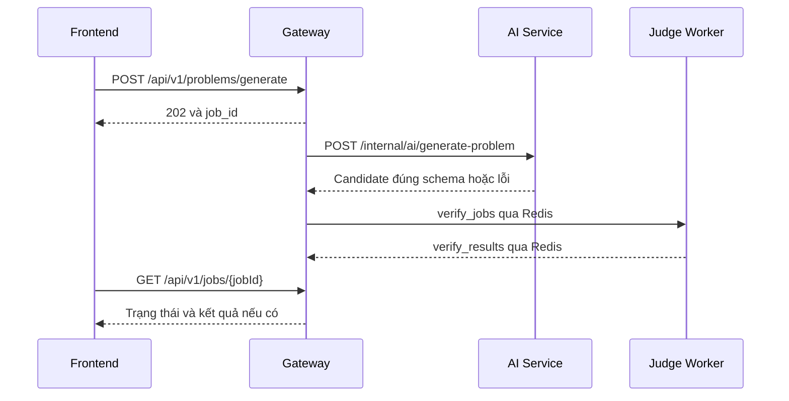

# Bản nháp thiết kế dịch vụ AI của Long

Ngày: 24/11/2026. Mốc: T12. Trạng thái: đề xuất để xem xét.

## 1. Bài toán và người dùng
Giáo viên cần tạo bài từ kỹ năng và độ khó mục tiêu. Học sinh cần hiểu nguyên nhân mã chạy chậm mà không nhận toàn bộ lời giải. Dịch vụ AI hỗ trợ hai nhu cầu này thông qua Gateway.

Gateway là API consumer trực tiếp của AI Service. Trình duyệt không giữ khóa nội bộ hoặc khóa model. Giáo viên và học sinh sử dụng API công khai do Gateway cung cấp.

## 2. Phạm vi MVP
- Sinh đề, định dạng vào/ra, constraints, ví dụ, generator Python và reference C++.
- Nhận source code và timings để trả phân tích độ phức tạp cùng câu hỏi Socratic.
- Kiểm tra request/response theo bốn JSON Schema hiện có.
- Xác thực nội bộ, timeout, bounded retry và mock xác định.

Chưa đưa agent orchestration, kho tái sử dụng, difficulty calibration, recommendation hay formal proof vào điều kiện T12/P0. Không tuyên bố số đo thời gian tự chứng minh Big-O hoặc bài sinh tự động luôn đúng.

## 3. Quyết định công nghệ đề xuất
Chọn Python FastAPI. JSON Schema trong `services/ai-service/schemas/` là nguồn hợp đồng. Model provider được đặt sau một interface chung với mock provider. Chốt dependency versions ở bước triển khai và kiểm thử T13.

Lựa chọn này thuận tiện cho xử lý JSON, model SDK và logic sinh bài trong thời hạn bốn tuần. Đổi lại, nhóm vận hành thêm một môi trường Python bên cạnh Go. Cần khóa dependencies, Docker và hướng dẫn chạy lại. Không thêm framework đa tác nhân vào MVP.

## 4. Ranh giới dịch vụ
| Thành phần | Trách nhiệm |
|---|---|
| Gateway — Khánh | JWT/RBAC, DB, job state, cache phân tích và điều phối |
| AI Service — Long | Input/schema, model request, output validation, generation/analysis và retry |
| Judge Worker — Nam | Chạy mã trong sandbox, verify/judge và timings |
| Frontend — Sơn | Chọn tags, yêu cầu phân tích, polling và hiển thị |

AI Service không ghi PostgreSQL và không nhận vai trò chấm mã. Response đúng schema chỉ là candidate; kết quả sandbox thuộc bước tiếp theo. Human publication gate đầy đủ thuộc P1 #16, chưa được coi là đã có trong P0.

## 5. Hợp đồng nội bộ
| Operation | Input chính | Output chính |
|---|---|---|
| POST `/internal/ai/generate-problem` | tags, difficulty, time_limit_ms, memory_limit_mb; weakness context tùy chọn | slug/title/statement/formats/constraints/complexity, sample_cases, 4 tiers, generator_code, reference_solution_cpp, model_version |
| POST `/internal/ai/analyze-complexity` | problem_title, target_complexity, language, source_code, verdict, subtask_timings | detected_complexity, target_complexity, bottleneck_summary, socratic_hint, guiding_questions, model_version |
| GET `/health` | Không có body | status, service, mock_ai |

Hai POST dùng `Content-Type: application/json` và `X-Internal-API-Key`. Đề xuất bảo vệ `/health` bằng cùng header để khớp README hiện có; chốt healthcheck với người cấu hình Compose trước T13. Không đưa key vào URL.

Giới hạn request theo schema hiện tại: 1–4 tags, difficulty 800–3500, time limit 500–10000 ms và memory 64–1024 MB. Language phân tích: cpp17/cpp20/python3. Guiding questions: 1–4 câu.

## 6. Kiểm tra nghiệp vụ ngoài schema
Schema bốn tiers chưa tự bảo đảm tier/max_n duy nhất và tổng điểm 100. Logic T13 cần kiểm tra thứ tự tiers 1–4, max_n tương ứng 100/1000/10000/100000, tổng điểm và limits nhất quán với request.

Cần kiểm tra ví dụ phù hợp statement/constraints, generator nhận N/seed qua sys.argv và không vượt limits. Việc compile/run phải diễn ra trong sandbox, không chạy mã sinh ra trực tiếp trên máy dịch vụ AI.

Phân tích timings phải xét trường hợp TLE là quan sát bị chặn bởi giới hạn thời gian. Không sử dụng các giá trị TLE như thời gian hoàn thành thật. detected_complexity là chẩn đoán có giới hạn, cần đối chiếu source code và kết quả thực nghiệm.

## 7. Lỗi và retry đề xuất
| Tình huống | Hành vi đề xuất |
|---|---|
| Thiếu/sai internal key | 401, không gọi provider |
| Input không đúng schema | 422, thông tin lỗi đã lọc |
| Provider 429/503 | Backoff có jitter, số lần và tổng thời gian giới hạn |
| Provider timeout | Dừng theo deadline, trả lỗi kiểm soát |
| Model trả JSON/schema sai | Không chuyển response lỗi thành candidate thành công |
| Hết retry | Dừng, báo lỗi rõ ràng để Gateway xử lý job |

Không retry lỗi input/auth. Đề xuất hiểu MAX_RETRIES là số lần gọi lại sau lần đầu; chốt rõ trong README và tests T13. Tôn trọng Retry-After nếu hợp lệ nhưng không vượt tổng deadline.

Mã lỗi nội bộ cho timeout/invalid output/upstream và mapping sang job/public error cần chốt với Khánh. Không mặc định các lỗi provider trùng mã public OpenAPI. Đây là thiết kế nháp, chưa sửa error contract.

## 8. Các điểm cần review
1. Chấp nhận FastAPI và cách khóa môi trường T13.
2. Xác thực `/health` và cách healthcheck lấy key an toàn.
3. Error mapping, retry semantics, timeout và request-size limits.
4. Model ID/quota thật và chính sách fallback có nhãn.
5. Hợp đồng metadata/log correlation không làm đổi API public.
