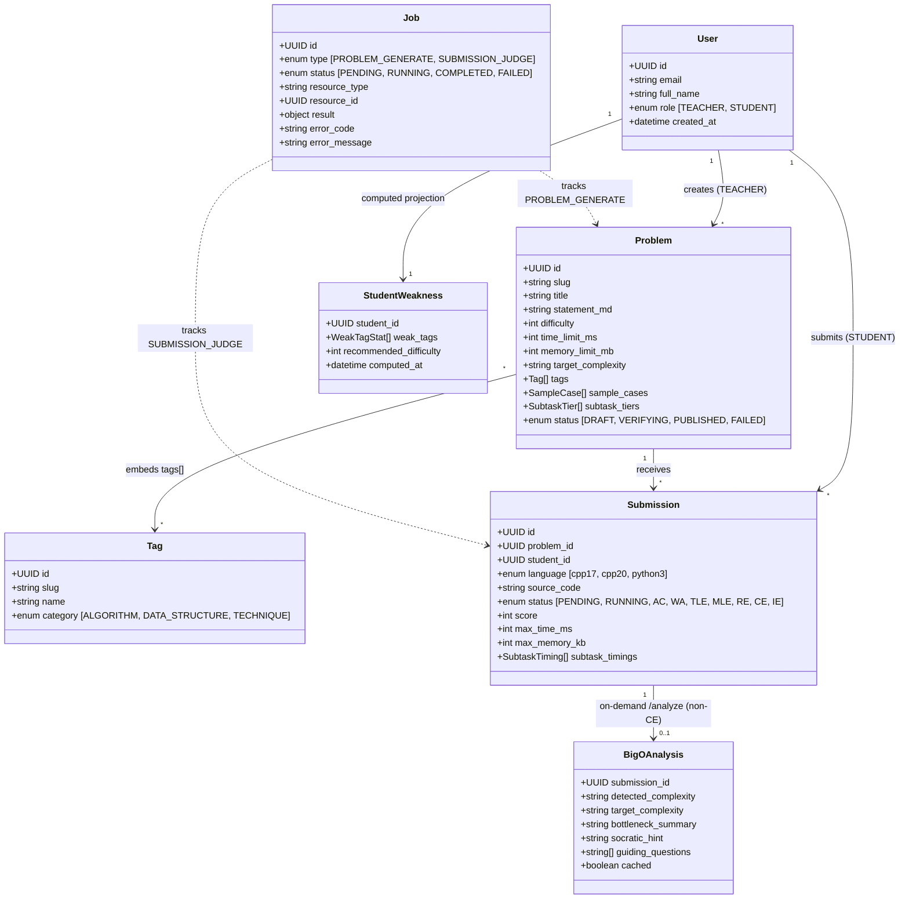
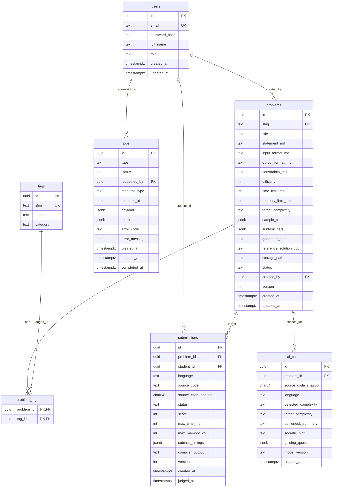
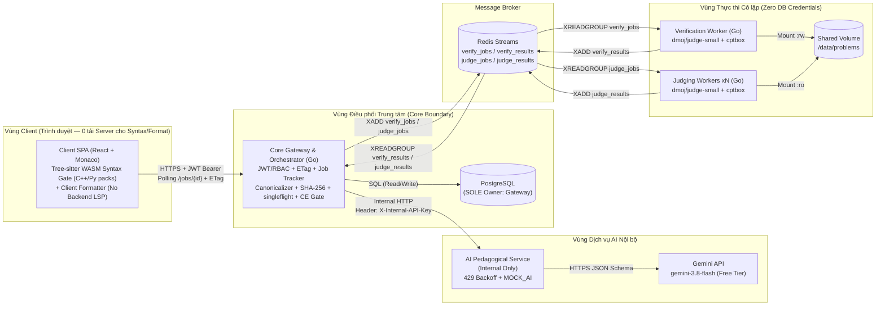
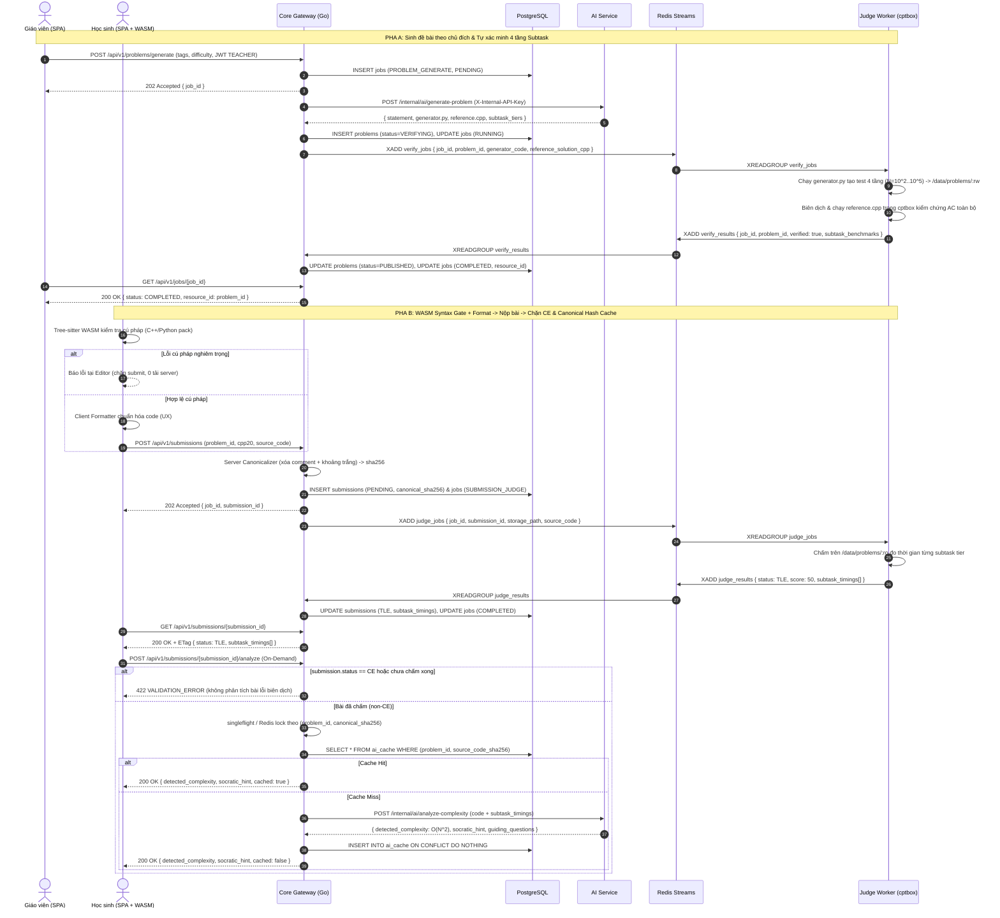

# Tài liệu Thiết kế Hệ thống (Design Document) — AlgoBloom *(Bản cập nhật: Nam)*

Tài liệu này mô tả chi tiết mô hình tài nguyên REST, sơ đồ cơ sở dữ liệu PostgreSQL, sự tách biệt giữa Resource Model và Database Schema, kiến trúc SOA (Gateway Orchestration), luồng tuần tự có **WASM Syntax Gate + Client Formatter + Server-side Canonical Hash / `singleflight` / CE Gate**, và chiến lược kiểm thử của **AlgoBloom**.

---

## 1. Mô hình Tài nguyên (Resource Model) & Quy ước Đặt tên

### 1.1 Quy ước Đặt tên & Định danh
- **Base path:** `/api/v1`
- **Tên tài nguyên:** Danh từ số nhiều, chữ thường, `kebab-case` cho đường dẫn: `/problems`, `/submissions`, `/tags`, `/jobs`, `/students/{studentId}/weaknesses`.
- **Trường JSON:** `snake_case` thống nhất toàn hệ thống (OpenAPI, PostgreSQL, Redis Streams, AI Service).
- **Định danh (Identifiers):** UUID v4 (`string`, format `uuid`).
- **Caching:** `GET /api/v1/problems/{problemId}` và `GET /api/v1/submissions/{submissionId}` trả về weak `ETag` (`W/"problem-<uuid>-v1"`) hỗ trợ `If-None-Match` -> `304 Not Modified`.
- **Tác vụ bất đồng bộ:** `POST /api/v1/problems/generate` và `POST /api/v1/submissions` trả về `202 Accepted` kèm `job_id` để client polling tại `GET /api/v1/jobs/{jobId}`.

### 1.2 Sơ đồ Mô hình Tài nguyên (Resource Model Diagram)

---

## 2. Sơ đồ Cơ sở Dữ liệu PostgreSQL (ERD)

Core Gateway (`services/gateway/`) là thành phần **duy nhất** sở hữu schema và kết nối trực tiếp tới PostgreSQL. Định nghĩa DDL chuẩn nằm tại `services/gateway/migrations/001_init.sql`.

> **Ghi chú kỹ thuật về `source_code_sha256`:** Cột `source_code_sha256` trong `submissions` và `ai_cache` luôn lưu mã băm `SHA-256` của **mã nguồn sau khi Gateway tự canonicalize** (xóa comment + chuẩn hóa khoảng trắng), tuyệt đối không băm chuỗi thô và không nhận hash do client gửi lên.

---

## 3. Vì sao Resource Model KHÁC với Database Schema?

| Khía cạnh | Trong PostgreSQL Schema | Trong Public REST Resource Model | Lý do tách biệt |
| :--- | :--- | :--- | :--- |
| **Quan hệ nhiều-nhiều `problems` <-> `tags`** | Bảng trung gian `problem_tags(problem_id, tag_id)` chuẩn hóa 3NF | Mảng nhúng `tags: Tag[]` ngay bên trong đối tượng `Problem` | Tránh N+1 request phía Frontend; bảng nối không có ý nghĩa độc lập với consumer. |
| **Hồ sơ điểm yếu (`StudentWeakness`)** | **Không có bảng riêng** (tổng hợp động bằng `JOIN`) | Tài nguyên chỉ đọc `GET /api/v1/students/{studentId}/weaknesses` | Dữ liệu dẫn xuất (computed projection), tránh dư thừa đồng bộ ở MVP. |
| **Bảng `ai_cache`** | Khóa duy nhất `(problem_id, source_code_sha256)` trên mã nguồn đã canonicalize | **Ẩn hoàn toàn** khỏi public API; chỉ biểu diễn qua `cached: boolean` | Caching & canonicalization là tối ưu nội bộ phía Gateway; không tin hash từ client. |
| **Trường nhạy cảm / nội bộ** | `password_hash`, `generator_code`, `reference_solution_cpp`, `storage_path`, `source_code_sha256` | **Loại bỏ hoàn toàn** khỏi response công khai | Bảo mật xác thực, chống gian lận lời giải mẫu và che giấu filesystem máy chủ. |
| **Cột `version`** | `version INT` trong `problems` và `submissions` | Ánh xạ thành HTTP Header `ETag: W/"problem-<id>-v<version>"` | Tận dụng cơ chế chuẩn HTTP `304 Not Modified`. |
| **Tài nguyên bất đồng bộ `Job`** | Lưu `payload` nội bộ + `(resource_type, resource_id)` | Chuẩn hóa `PENDING`/`RUNNING`/`COMPLETED`/`FAILED` + `resource_id` | Che giấu chi tiết Redis Streams và dễ mở rộng loại job mới. |

---

## 4. Kiến trúc Hệ thống SOA (System Architecture Diagram)

### Tóm tắt Ranh giới Tin cậy (Trust Boundaries)

1. **Public Edge (`SPA -> Gateway`):** Chỉ cho phép HTTPS + JWT Bearer (`TEACHER` / `STUDENT`). Client chạy Tree-sitter WASM Syntax Gate & Formatter để cải thiện UX và chặn sớm lỗi cú pháp, nhưng **Gateway không bao giờ tin đầu vào đã format hay hash từ client** — Gateway luôn tự canonicalize và tự tính `sha256`.
2. **Internal AI Boundary (`Gateway -> AI Service`):** AI Service không mở port ra ngoài Internet; bắt buộc kiểm tra header `X-Internal-API-Key`.
3. **Sandbox Isolation (`Redis Streams -> Judge Workers`):** Judge Workers chạy code không tin cậy bên trong `cptbox`, **ZERO DB credentials**. Verification Worker mount `/data/problems:rw`; Judging Workers chỉ đọc `:ro`.

### Điểm mở rộng Kiến trúc cho P1 / P2 (Không phá vỡ hợp đồng P0 — Theo #15)

- **P1 (Machine Loop — #16, #17):** Kiến trúc Gateway Orchestration cho phép cắm vòng lặp **Self-Revision** (khi `verify_results.verified == false`, Gateway gọi lại AI Service với phản hồi lỗi tối đa `max_revisions` lần) và mở rộng trường tùy chọn `adversarial_solutions[]` trên `verify_jobs` để Judge Worker kiểm chứng mutation kill rate mà không thay đổi luồng P0.
- **P2 (Human Loop — #18, #19):** Sau khi P0/P1 ổn định, có thể bổ sung bảng `problem_feedback`, cột `calibrated_difficulty` và endpoint đánh giá chất lượng đề để cung cấp dữ liệu hiệu chỉnh độ khó thực nghiệm cho AI Service.

---

## 5. Sơ đồ Tuần tự Luồng Trọng tâm (Sequence Diagram)

---

## 6. Ngăn xếp Công nghệ & Chiến lược Kiểm thử

### 6.1 Tech Stack
- **Frontend:** React + TypeScript + `@monaco-editor/react` + **`web-tree-sitter` (WASM language packs: C++, Python) + Client Formatter** (không chạy Backend Full LSP).
- **Core Gateway:** Go (`net/http`, `pgx`, `go-redis`, `golang.org/x/sync/singleflight`), PostgreSQL 16, Redis 7 Streams.
- **Judge Worker:** Go Redis Streams consumer bọc `dmoj/judge-small` (`dmoj-cli` + `cptbox`).
- **AI Service:** Python (FastAPI) gọi `gemini-3.8-flash` với structured JSON output (chi tiết tại `docs/long/`).
- **Contract & Mock Tooling:** OpenAPI 3.0.3, Swagger UI (`swaggerapi/swagger-ui`), Stoplight Prism 4 (`stoplight/prism:4`).

### 6.2 Chiến lược Kiểm thử (Testing Strategy)
1. **Tuần 12 (Contract-First Validation):** Kiểm tra OpenAPI 3.0.3, chạy `docker-compose.mock.yml`, chạy Postman Collection trên Prism.
2. **Tuần 13–14 (Unit, Integration & Sandbox Verification):**
   - **Go Gateway:** `httptest` kiểm chứng JWT/RBAC, `ETag` `304`, **canonicalizer (thêm space / comment ra cùng 1 `sha256`)**, `422` khi gọi `/analyze` trên bài `CE`, và **concurrent test 2 request song song vào `/analyze` chỉ gọi AI Service đúng 1 lần (`singleflight`)**.
   - **Frontend:** Kiểm chứng Tree-sitter WASM chặn lỗi cú pháp C++/Python trước khi gửi request và formatter chạy đúng trước `POST /submissions`.
   - **Judge Worker:** Kiểm thử `AC` $O(N \log N)$ vs `TLE` $O(N^2)$ trong `cptbox` qua Redis Streams.
   - **AI Service:** Kiểm thử JSON Schema validation ở cả `MOCK_AI=true` và `gemini-3.8-flash` thật + retry `429`.
