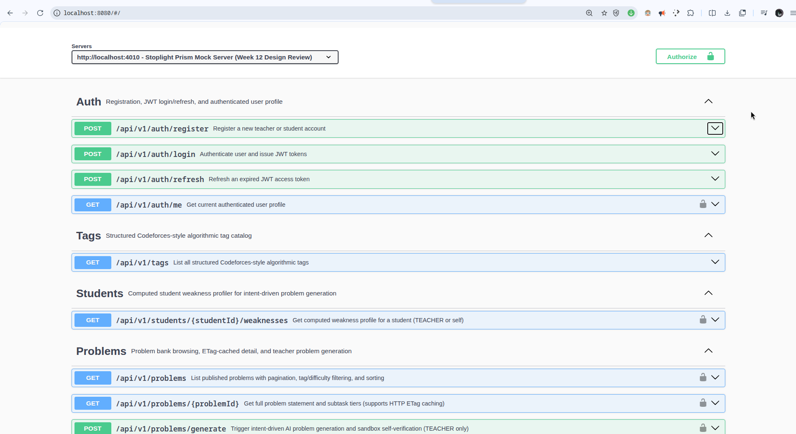

# Báo cáo Tiến độ Tuần 12 — Phần Đóng góp của Nam (`docs/nam/`)

- **Thành viên:** Nam (`@thep1ckaxe91`) — Judge Infra, Redis Broker & Kiến trúc hệ thống
- **PR liên quan:** https://github.com/thep1ckaxe91/AlgoBloom/pull/20 (nhánh `docs/w12-align-ai-roadmap`)
- **Quy ước thư mục:** Bản cập nhật của Nam được tách riêng tại `docs/nam/` (khớp chuẩn `docs/long/` của Long) để tránh merge conflict với PR của Sơn (#27 — đã merge), Long (#22–#26) và Khánh; bản tổng hợp vào `docs/*.md` sẽ được ghép ở bước chốt cuối.

---

## 1. Công việc đã hoàn thành (Nam — Tuần 12)

1. **Bootstrap Monorepo, Hợp đồng & Khung Tuần 13 (`9de57f3`):**
   - Khởi tạo toàn bộ cấu trúc monorepo SOA (`contracts/openapi.yaml`, `contracts/redis-schemas.json`, `docker-compose.mock.yml`, khung `services/gateway` + migrations `001_init.sql`/`002_seed.sql`, `services/judge-worker`, `services/ai-service/schemas`, `frontend/README.md`, Postman starter collection).
   - Thiết lập hệ thống nhãn & phân rã toàn bộ GitHub Issues cho Tuần 12–13 (#1–#14).
2. **Tiếp nhận & Phân pha Đề xuất Mở rộng AI Service (#15 → #16–#19):**
   - Phối hợp với Long chốt lộ trình **P0 → P1 (Machine Loop) → P2 (Human Loop)** giữ nguyên hợp đồng P0 Tuần 12–13; cập nhật issues #3, #11, #12 và tạo 4 follow-up issues #16–#19.
3. **Chốt Kiến trúc Chống Spam CE & Chống Lách Cache (`ADR-05`, `ADR-06`):**
   - Phối hợp với Khánh phân tích và chốt **Option 1**:
     - Client dùng **Tree-sitter WASM Syntax Gate** (kiến trúc language pack `.wasm` cho C++, Python, dễ mở rộng) + **Client Formatter** (không dựng Backend Full LSP `clangd`/`pyright`).
     - Gateway bắt buộc **tự canonicalize** (xóa comment + chuẩn hóa khoảng trắng), **tự tính `sha256` ở server**, dùng **`singleflight`/Redis lock** chặn bấm 2 tab đồng thời và **chặn cứng `422`** khi gọi `/analyze` trên bài `CE`.
4. **Review & Merge PR #27 của Sơn (`bdb59e2`):**
   - Đã `gh pr checkout 27`, kiểm chứng Project Brief, 3 wireframe SVG, bộ 7 slide PDF và 6 ảnh mock, approve và merge vào `main` (đóng Issue #4).
5. **Kiểm chứng Stack Demo Swagger UI + Prism Mock:**
   - Đã chạy thực tế `docker compose -f docker-compose.mock.yml up`, xác nhận Swagger UI (`http://localhost:8080`) kết nối Stoplight Prism Mock Server (`http://localhost:4010`) hoạt động đúng.

---

## 2. Minh chứng Kiểm thử Swagger UI (`localhost:8080` → `localhost:4010`)

---

## 3. Việc còn lại trước giờ chốt Tổng hợp Tuần 12

- [ ] Review & merge PR của Long (Tuần 12: #22, #23) và PR của Khánh (#2 — Postman trên Prism + `docs/khanh/`).
- [ ] Tổng hợp cuối cùng các bản cập nhật từ `docs/nam/`, `docs/khanh/`, `docs/long/`, `docs/son/` vào bộ tài liệu chính `docs/*.md` và cập nhật mục Minh chứng chung trong `docs/progress-report-w12.md`.
